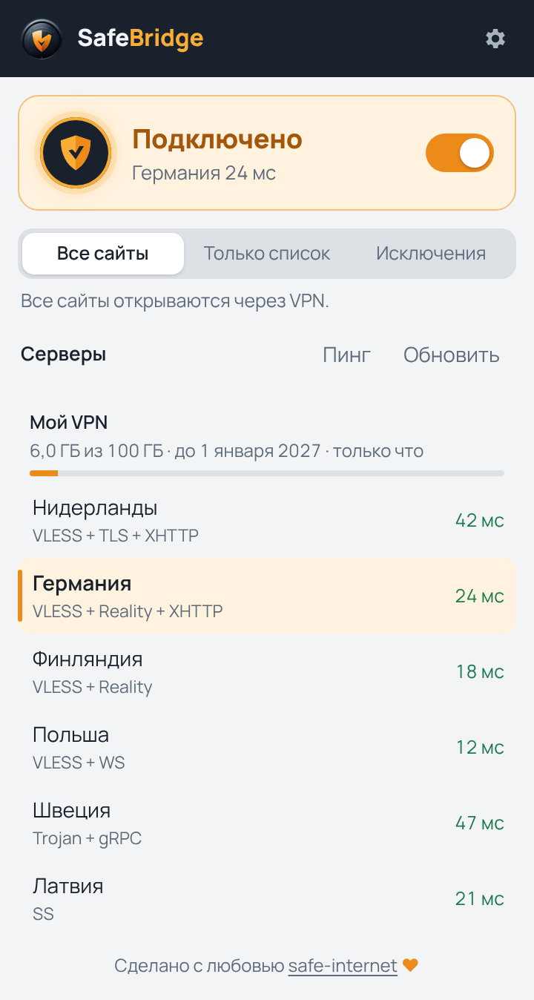
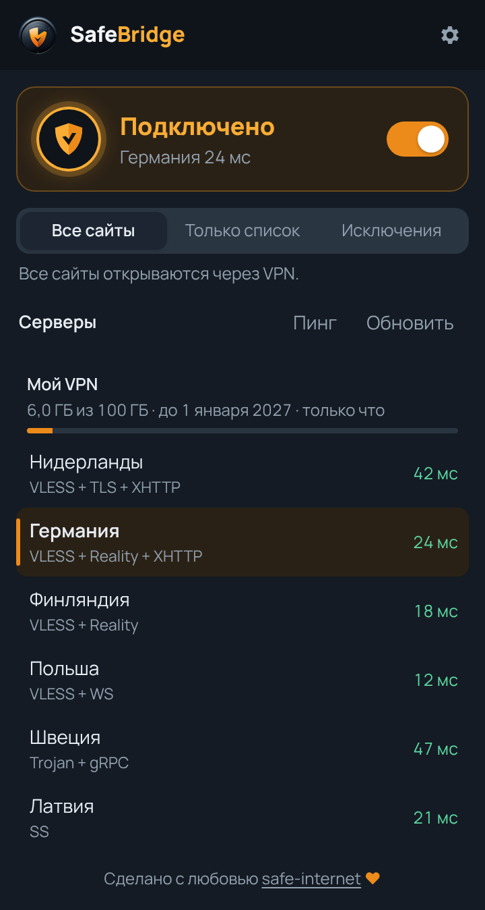
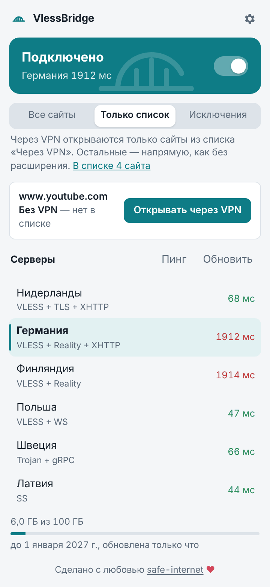
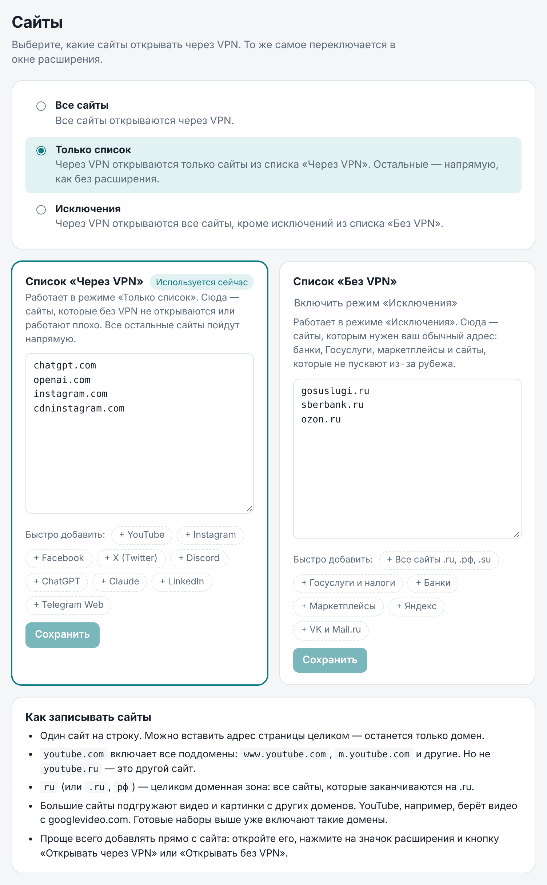
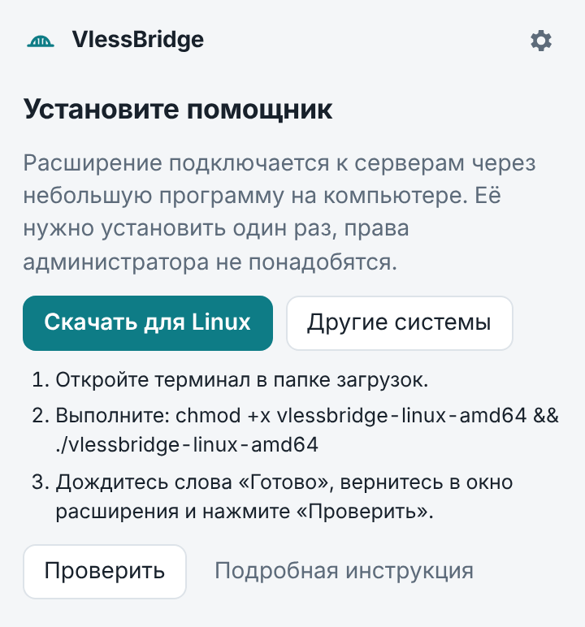
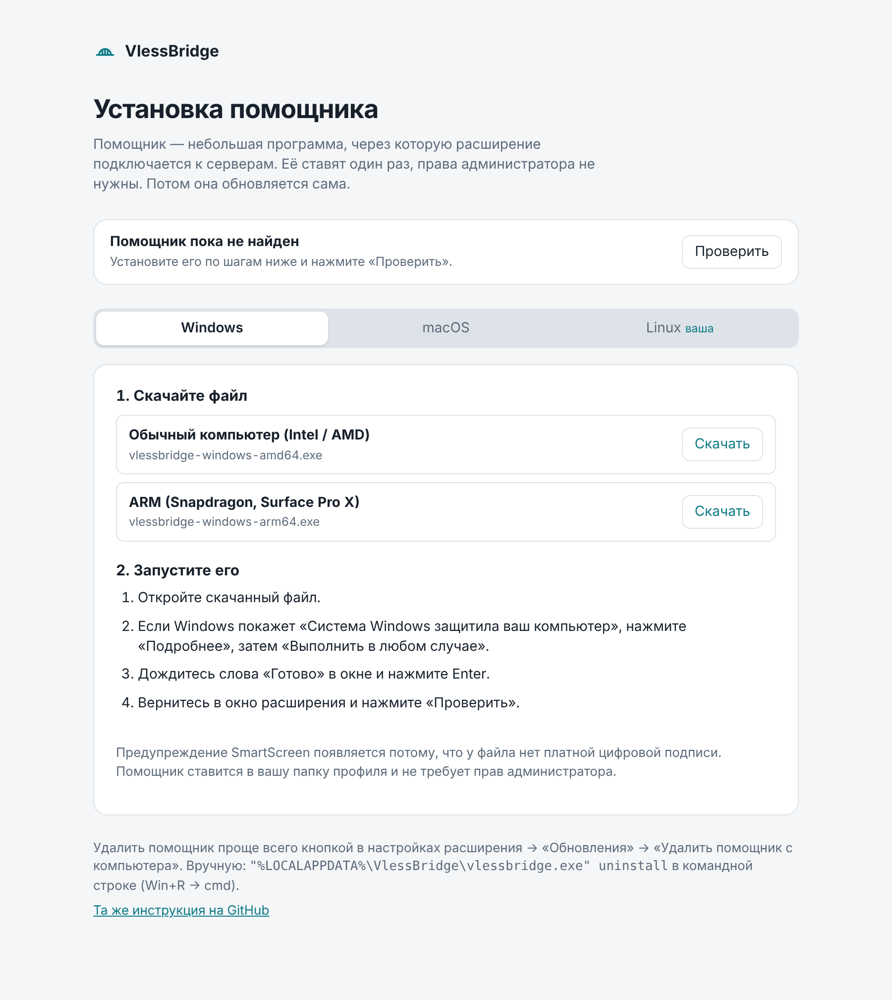
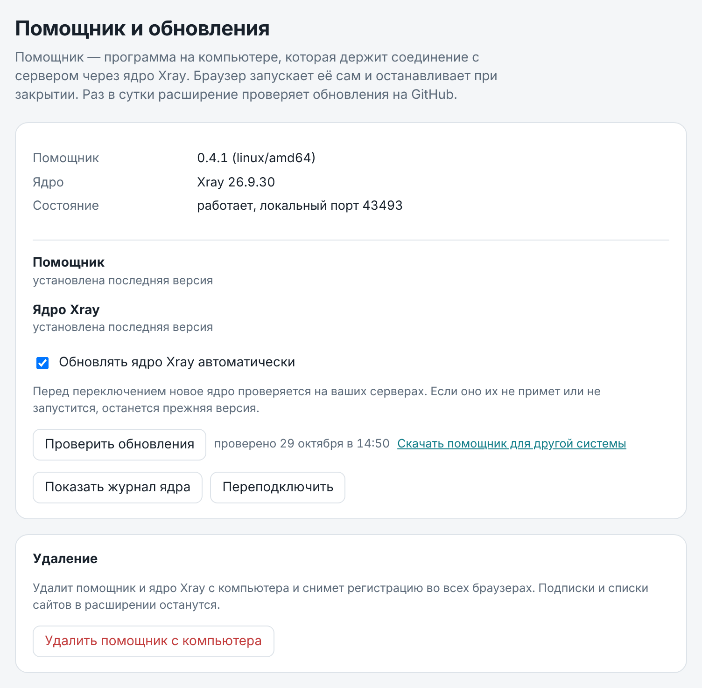

# VlessBridge

VPN для браузера по протоколу VLESS. Вы вставляете ссылку-подписку от своего VPN-сервиса, выбираете сервер и решаете, какие сайты открывать через VPN, а какие напрямую. Работает в Firefox, Chrome, Edge, Brave, Яндекс Браузере, Vivaldi и Chromium на Windows, macOS и Linux.

Через VPN идёт только браузер — остальные программы на компьютере работают как обычно.

<p align="center">
  
  
  
</p>

## Как это работает

```
браузер ──▶ расширение VlessBridge ──▶ помощник на компьютере (ядро Xray) ──▶ VPN-сервер ──▶ сайт
```

Браузер сам не умеет подключаться по VLESS, поэтому VlessBridge состоит из двух частей:

- **Расширение** — то, что вы видите в браузере: список серверов, кнопка включения, выбор сайтов. Оно направляет трафик браузера в помощник.
- **Помощник** — небольшая программа на компьютере со встроенным ядром [Xray](https://github.com/XTLS/Xray-core). Она и держит соединение с VPN-сервером. Браузер запускает помощник сам, когда он нужен, и закрывает вместе с собой. Ставится один раз, права администратора не нужны.

## Возможности

- **Серверы из подписки.** Вставьте ссылку из личного кабинета или бота VPN-сервиса — серверы загрузятся сами. Подписка обновляется каждые 2 часа (интервал можно изменить), есть кнопка «Обновить». Видно остаток трафика и срок действия, если сервис их сообщает.
- **Выбор сервера.** Список с пингом каждого сервера, переключение за доли секунды. Выбранный сервер сохраняется при обновлении подписки.
- **Только нужные сайты.** Три режима:
  - **Все сайты** — всё через VPN;
  - **Только список** — через VPN только сайты из списка «Через VPN», остальные напрямую;
  - **Исключения** — всё через VPN, кроме списка «Без VPN» (например, банки и Госуслуги).

  Сайт добавляется в список одной кнопкой прямо с его страницы. Есть готовые наборы: YouTube, Instagram, ChatGPT и другие — для VPN; Госуслуги, банки, маркетплейсы, вся зона .ru — без VPN.
- **Обновления сами.** Ядро Xray обновляется автоматически: перед переключением новая версия проверяется на ваших серверах, а если не подойдёт — остаётся прежняя. О новой версии помощника расширение сообщит, обновление — одной кнопкой.
- **Защита от утечек.** Если соединение с сервером пропало, сайты, которые должны идти через VPN, не откроются напрямую с вашего настоящего адреса (kill switch, можно выключить), а расширение само переподключится. WebRTC не выдаёт настоящий IP в режиме «Все сайты». Подробнее о безопасности — в [SECURITY.md](SECURITY.md).

<p align="center">
  
</p>

**Протоколы:** VLESS (Reality, XHTTP, TLS, Vision, WebSocket, gRPC, HTTPUpgrade, mKCP, VLESS Encryption), Trojan, VMess, Shadowsocks (включая 2022) и Hysteria2.

Серверы, с которыми ядро Xray работать не может, показываются серыми, причина написана под названием. Это VLESS без шифрования на публичный адрес, устаревшие транспорты HTTP/2 и QUIC, VMess с `alterId` больше 0, плагины Shadowsocks и диапазоны портов Hysteria2.

## Установка

### 1. Расширение

#### Chrome, Edge, Brave, Яндекс Браузер, Vivaldi

1. Скачайте [vlessbridge-extension.zip](https://github.com/maxhoney920/SafeBridge/raw/downloads/vlessbridge-extension.zip) и распакуйте его. Папку `VlessBridge` не перемещайте и не удаляйте: браузер загружает расширение из неё.
2. Откройте страницу расширений: `chrome://extensions` (Edge — `edge://extensions`, Яндекс Браузер — `browser://extensions`).
3. Включите «Режим разработчика» (переключатель справа вверху).
4. Нажмите «Загрузить распакованное» и выберите папку `VlessBridge` — ту, внутри которой лежит `manifest.json`.
5. Закрепите значок расширения на панели (значок пазла → булавка).

#### Firefox

Нужен Firefox 115 или новее. Откройте [vlessbridge-firefox.xpi](https://github.com/maxhoney920/SafeBridge/raw/downloads/vlessbridge-firefox.xpi) в Firefox и нажмите «Добавить». Дополнение подписано Mozilla, ставится насовсем и обновляется вместе с новыми версиями.

Firefox из Flatpak помощника не видит: песочница Flatpak не даёт запускать программы снаружи. Используйте Firefox из пакета или с сайта Mozilla (snap-версия в Ubuntu тоже должна работать, но она не проверялась).

Расширение само предложит установить помощник и даст кнопку для вашей системы. Подробная страница установки со всеми файлами есть и внутри расширения. Помощник один и тот же для всех браузеров.

### 2. Помощник

<p align="center">
  
  
</p>

| Система | Процессор | Файл |
|---|---|---|
| Windows | Intel / AMD | [vlessbridge-windows-amd64.exe](https://github.com/maxhoney920/SafeBridge/raw/downloads/vlessbridge-windows-amd64.exe) |
| Windows | ARM (Snapdragon) | [vlessbridge-windows-arm64.exe](https://github.com/maxhoney920/SafeBridge/raw/downloads/vlessbridge-windows-arm64.exe) |
| macOS | Apple Silicon (M1–M4) | [vlessbridge-macos-arm64.zip](https://github.com/maxhoney920/SafeBridge/raw/downloads/vlessbridge-macos-arm64.zip) |
| macOS | Intel | [vlessbridge-macos-amd64.zip](https://github.com/maxhoney920/SafeBridge/raw/downloads/vlessbridge-macos-amd64.zip) |
| Linux | x86-64 | [vlessbridge-linux-amd64](https://github.com/maxhoney920/SafeBridge/raw/downloads/vlessbridge-linux-amd64) |
| Linux | ARM64 | [vlessbridge-linux-arm64](https://github.com/maxhoney920/SafeBridge/raw/downloads/vlessbridge-linux-arm64) |

#### Windows

1. Скачайте `vlessbridge-windows-amd64.exe` и откройте его.
2. Если появится «Система Windows защитила ваш компьютер», нажмите «Подробнее», затем «Выполнить в любом случае». Предупреждение появляется потому, что у файла нет платной цифровой подписи.
3. В окне появится отчёт об установке и слово «Готово». Нажмите Enter.
4. Вернитесь в окно расширения и нажмите «Проверить».

#### macOS

**Проще всего — одной командой.** Откройте Терминал (Программы → Утилиты → Терминал), вставьте и нажмите Return:

```sh
curl -fsSL https://github.com/maxhoney920/SafeBridge/raw/downloads/install.sh | sh
```

Команда сама выберет файл под ваш процессор, разрешать запуск в настройках не придётся.

**Или вручную:**

1. Скачайте `vlessbridge-macos-arm64.zip` (на Mac с Intel — `-amd64.zip`) и откройте архив двойным щелчком — рядом появится файл `vlessbridge`.
2. Откройте `vlessbridge` двойным щелчком. macOS скажет, что не может проверить разработчика, — нажмите «Готово».
3. Откройте Системные настройки → «Конфиденциальность и безопасность», внизу нажмите «Всё равно открыть» и подтвердите паролем.
4. В окне Терминала появится «Готово». Вернитесь в окно расширения и нажмите «Проверить».

#### Linux

Одной командой:

```sh
curl -fsSL https://github.com/maxhoney920/SafeBridge/raw/downloads/install.sh | sh
```

Или вручную, из папки со скачанным файлом:

```sh
chmod +x vlessbridge-linux-amd64
./vlessbridge-linux-amd64
```

Вернитесь в окно расширения и нажмите «Проверить».

#### Куда ставится помощник

Помощник копирует себя в папку вашего профиля и регистрируется во всех найденных браузерах, включая Firefox. Скачанный файл после установки можно удалить.

| Система | Папка помощника |
|---|---|
| Windows | `%LOCALAPPDATA%\VlessBridge` |
| macOS | `~/Library/Application Support/VlessBridge` |
| Linux | `~/.local/share/vlessbridge` |

### 3. Подключение

1. Нажмите на значок VlessBridge и вставьте ссылку-подписку.
2. Выберите сервер и нажмите на большую кнопку — на ней появится «Подключено».
3. Если нужно, выберите режим «Только список» или «Исключения» и добавьте сайты.

## Удаление

<p align="center">
  
</p>

**Кнопкой.** Откройте настройки расширения → «Обновления» → «Удалить помощник с компьютера». Помощник остановится, снимет регистрацию во всех браузерах и удалит свою папку. После этого там же появится кнопка «Удалить и расширение».

**Вручную**, если расширения уже нет:

1. Удалите помощник командой:
   - Windows (Win+R → `cmd`): `"%LOCALAPPDATA%\VlessBridge\vlessbridge.exe" uninstall`
   - macOS (Терминал): `~/Library/Application\ Support/VlessBridge/vlessbridge uninstall`
   - Linux: `~/.local/share/vlessbridge/vlessbridge uninstall`
2. Удалите расширение: в Chrome — на странице `chrome://extensions`, в Firefox — в `about:addons`.

Если папка помощника осталась (например, команду запустили, когда файла уже не было), её можно просто удалить — пути указаны в таблице «Куда ставится помощник».

## Если что-то не работает

- **Расширение всё время просит установить помощник** — перезапустите браузер после установки. В Firefox помощник должен быть версии 0.4.0 или новее: старые версии регистрировались только в Chrome.
- **«Настройками прокси управляет другое расширение»** — отключите другие VPN- и прокси-расширения: управлять прокси в браузере может только одно.
- **Сервер серый с пометкой «не поддерживается»** — ядро Xray не может с ним работать, причина написана под названием.
- **Не подключается** — откройте настройки расширения → «Обновления» → «Показать журнал ядра».
